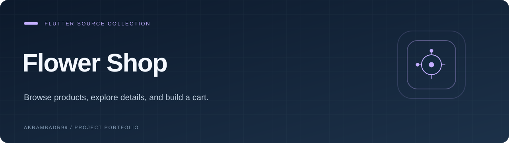

  

<strong>Browse products, explore details, and build a cart.</strong>

<a href="#overview">Overview</a> · <a href="#explore">Explore</a> · <a href="#getting-started">Getting started</a>

<code>Flutter</code> · <code>Dart</code>

## Overview

A collection of Flutter shopping-app source files, stored in the **Project** repository. The code includes product browsing, details, cart state, and account screens.

## Explore

- Product grid and details
- Cart quantities and totals
- Checkout screen
- Login and registration screens
- Product image assets

## Getting started

This repository contains source files and image assets, but no `pubspec.yaml` or complete Flutter project scaffolding. Integrate the files into a Flutter project, restore the `flower_app` package structure and dependencies (including Provider), and declare assets before attempting to run it.

## Project notes

A source collection, not a ready-to-install application. Account screens do not establish a deployed authentication service.

---

<a href="https://github.com/Akrambadr99?tab=repositories">Explore the portfolio</a>

